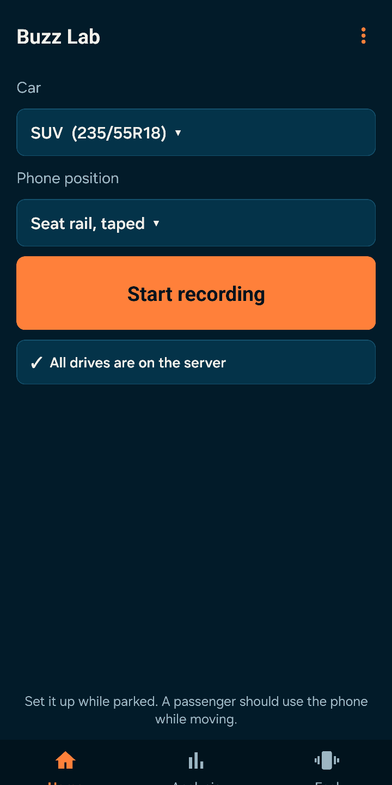
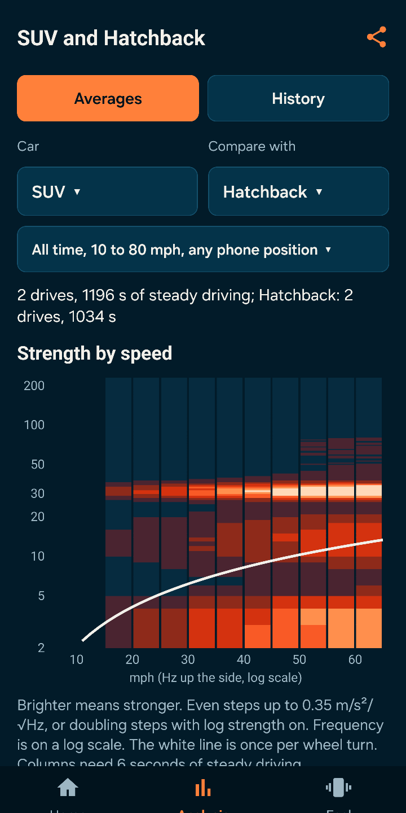
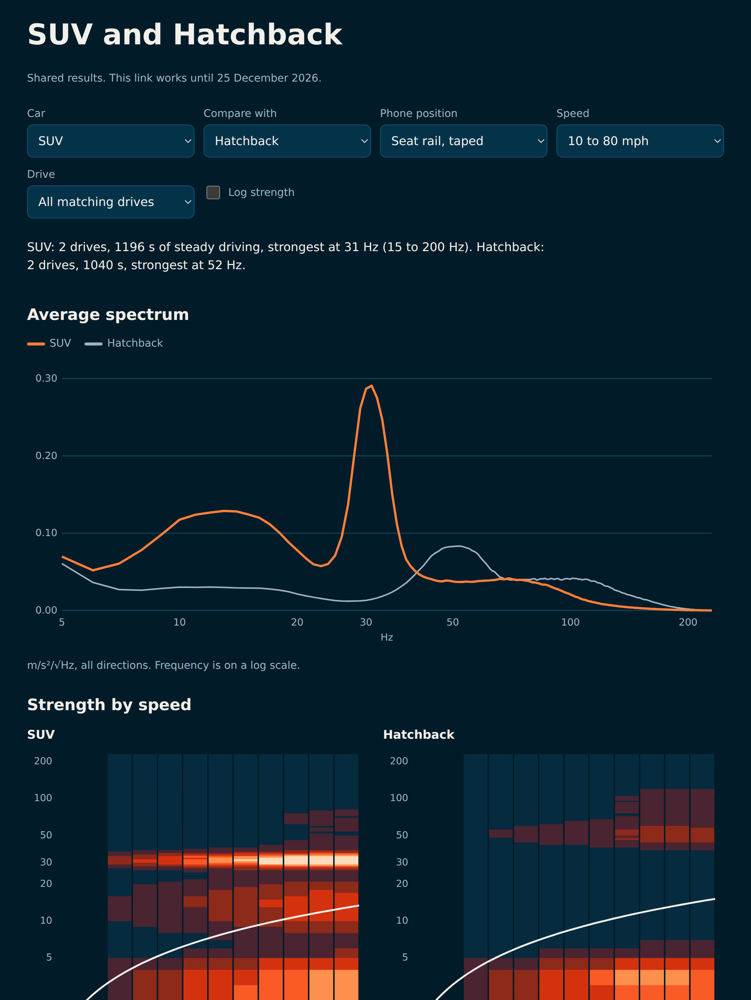

# Buzz Lab

Records vibration in a car with a phone, and shows whether it stays at one frequency or climbs with wheel speed.

> **This was fully vibe coded.** An AI wrote the code, guided by one person. It's a personal project to help analyse my own car. It hasn't been professionally reviewed, it comes with no support or warranty, and its results aren't a diagnosis. Don't use it for safety decisions, and don't use your phone while driving.

| Record | Compare |
|---|---|
|  |  |

A shared results page:

The cars and drives in these screenshots are made up.

- `app/`: Android app in plain Java, no Gradle. Records the accelerometer at full rate with GPS speed, draws strength by speed and frequency, averages drives per car, exports, and syncs. A Feel tab plays calibrated pulses through the phone's haptic audio channel.
- `server/`: one Go binary with SQLite and basic auth. Its API guide is `server/llms.txt`.
- `tools/`: Python analysis (numpy, scipy) for the CSV layout the app and phyphox export.

## App
`app/build.sh <sdk>` needs a folder holding a JDK in `jdk/`, plus an Android platform and build-tools. It makes a signing key in `app/.keys` the first time. Keep that key: without it, updates mean uninstalling the app, which deletes its drives. The build is debuggable and has developer hooks, so treat it as a personal build.

## Server
Set `BUZZ_USER` and `BUZZ_PASS` (16 characters or more), and optionally `BUZZ_DATA`, `BUZZ_ADDR` and `BUZZ_APK`. Put it behind HTTPS: the app refuses plain http. Uploads can include positions, so keep it private.

    cd server && go test ./... && go build -o buzz-backend .

## Share links
The app can make a read-only web page of chosen drives, with an expiry and an optional PIN. Links are random keys, stored only as hashes. They never show positions, plates, notes or raw readings.

## Reading results
A phone resting loosely can add its own resonance. Compare drives only on the same road, phone position and speed. The numbers do not show a cause.
